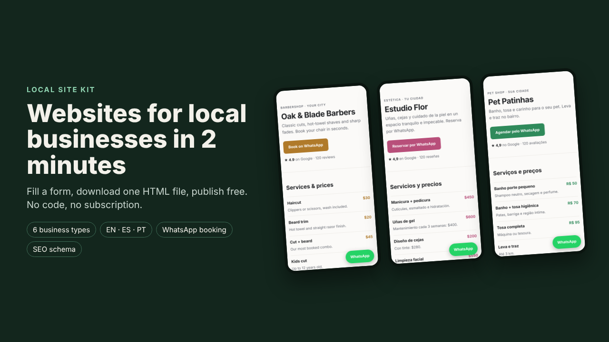

# Local Site Kit Lite

**A free, one-file website template for local businesses**: barbershops first, in **English, Spanish and Portuguese**. It's mobile-first, has a WhatsApp booking button, and is a single HTML file under 10 KB with no build step and no dependencies. You can host it free.

## Live demo
[English](https://htmlpreview.github.io/?https://github.com/Matheuszinhorn/local-site-kit-lite/blob/main/templates/barbershop-en.html) · [Español](https://htmlpreview.github.io/?https://github.com/Matheuszinhorn/local-site-kit-lite/blob/main/templates/barbershop-es.html) · [Português](https://htmlpreview.github.io/?https://github.com/Matheuszinhorn/local-site-kit-lite/blob/main/templates/barbershop-pt.html)

## Features
- "Book on WhatsApp" button and a floating WhatsApp button, both with a pre-filled message
- Services and prices, reviews, opening hours, Google Maps directions and click-to-call
- Automatic dark mode (follows the visitor's phone setting)
- `LocalBusiness` / `BarberShop` schema.org data so search engines understand the business
- No JavaScript, no external fonts, no trackers, under 10 KB

## Quick start
1. Download the template in your language from `templates/` (open the file, then click "Download raw file").
2. Open it in any text editor (Notepad, TextEdit, VS Code).
3. Replace the sample values. The comment at the top of the file lists them all:
   - business name, city, address
   - WhatsApp and phone numbers: search for `555`, `+52 55` or `+55 11`
   - services and prices, opening hours
   - reviews and the rating: **these are fictional**. Delete them or use real ones, and update the `ld+json` block too
4. Rename the file to `index.html`.

## Publish for free
- **Netlify Drop:** open [app.netlify.com/drop](https://app.netlify.com/drop) and drag the folder that contains `index.html`. You get a link in seconds.
- **GitHub Pages:** create a repository, upload `index.html`, then go to Settings → Pages → Deploy from branch.
- **Cloudflare Pages:** Create project → Direct upload.

A custom domain is optional, and you register it yourself (usually about US$ 10–15 per year).

## Limitations
- One business type (barbershop) and one page. Other niches only come in the full kit.
- No booking calendar or payments. Bookings go through WhatsApp.
- Photos aren't included. Add `` tags with your own images if you want them.
- Editing is by hand in the HTML file. The full kit has a form-based builder instead.

## Need help, found a bug, or want more?
- **Bug or question:** [open an issue](../../issues/new/choose). We reply in the issue.
- **Full Local Site Kit:** a no-code builder with live preview, 6 business types (barbershop, beauty, pet grooming, bakery, auto repair, personal trainer) and 3 languages. [See the kit](https://htmlpreview.github.io/?https://github.com/Matheuszinhorn/Matheuszinhorn/blob/ccr-fb47334b-mm7jqd/DESAFIO-CLAUDE-50-ATE-10000/vitrine/kit/index.html).
- **Done-for-you website:** we build and publish your site.

To order either one, [open an order issue](../../issues/new?template=order.md). Please don't post phone numbers or emails in public issues.

---
### Português
Template gratuito de site de uma página para barbearias, em PT/ES/EN, com botão de WhatsApp, preços, horários, mapa e SEO local. Baixe o arquivo em `templates/`, troque os dados de exemplo (a nota e as avaliações são **fictícias**) e publique de graça no Netlify Drop. Dúvidas, erros ou pedidos do kit completo: [abra uma issue](../../issues/new/choose).

### Español
Plantilla gratuita de sitio de una página para barberías, en ES/EN/PT. Descarga el archivo de `templates/`, reemplaza los datos de ejemplo (la nota y las reseñas son **ficticias**) y publícalo gratis en Netlify Drop. Dudas, errores o pedidos del kit completo: [abre un issue](../../issues/new/choose).

---
License: [MIT](LICENSE) for the files in this repository. The full kit is a separate product with its own license.
